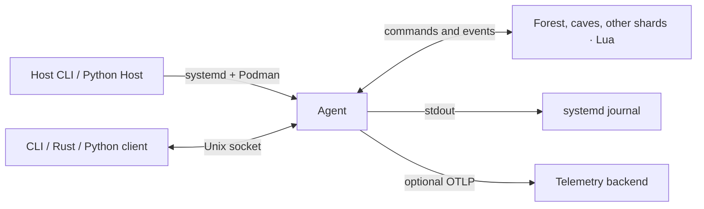

# Don't Starve Together Dedicated Server

English · [简体中文](README.zh-Hans.md) · [Releases](https://github.com/LetsStarveTogether/dst-server/releases)

Run a Don't Starve Together room with a Rust Agent, manage it from the CLI or Python, and review what players did.
A room has one container and one Agent for all its shards.
The Agent stays reachable on a local Unix socket while the room is closed between scheduled openings.



## Open a Room

Use a Linux x86_64 host with systemd and Podman Quadlet.
Install the CPython 3.15 wheel from the same release as the game image.
The wheel includes the `dst-server` command.
To build a matching image and CLI locally, follow the [source build instructions](docs/deployment.md#build-from-source).

The example creates room 299 under `/srv/dst` using a system service.
Run it as the account that manages the system Quadlet directory.
Put a Klei server token in `/run/secrets/dst_cluster_token` and pull the image before the first start.

```sh
podman pull quay.io/wh2099/dst-server:latest
```

```python
import asyncio
from pathlib import Path

from dst_server import Host
from dst_server.settings import Room, build_template

token = Path("/run/secrets/dst_cluster_token").read_text().strip()
room = Room(
    number=299,
    template="pure_survival",
    cluster=build_template("pure_survival", number=299, token=token),
    deployment={"volume_idmap": "uids=0-1000-1;gids=0-1000-1"},
)
asyncio.run(Host("/srv/dst", "/etc/containers/systemd").create(room))
```

The volume mapping gives the game's UID/GID 1000 access to the example's root-owned files.
Adjust it for your host's ownership.

```sh
dst-server host start --room 299
dst-server host status --room 299
dst-server call list_players --socket /srv/dst/299/.dst-agent.sock
```

## Everyday Operations

| Task | Command |
| --- | --- |
| List managed rooms | `dst-server host list` |
| Ask the game to save | `dst-server call save --socket /srv/dst/299/.dst-agent.sock` |
| Follow the room log | `dst-server logs journal --unit dst-299.service --follow` |
| Export a backup | `dst-server archive export 299 --output room-299.7z` |
| Inspect a backup before restoring | `dst-server archive import room-299.7z` |
| Look up game calls and arguments | `dst-server describe` or `dst-server describe --shard` |

Stop the service before editing its files.
A Host edit updates the native settings and the generated Quadlet together.

```sh
dst-server host stop --room 299
dst-server host edit --room 299 --set '/cluster/settings/max_players=12'
dst-server host start --room 299
```

## Guides

- [Room configuration, SDK calls and archives](docs/rooms.md) covers templates, Mods, players and restoring game progress.
- [Gameplay history and telemetry](docs/observability.md) shows how to select events and count a player's actions.
- [Deployment](docs/deployment.md) covers scheduled openings, maintenance, recovery and replacing an existing room.
- [Testing](docs/testing.md) includes Rust, Python, Lua and private game server checks.

[Steam community](https://steamcommunity.com/groups/lst99) · [Discord](https://discord.gg/4N3aeNsFt8)
