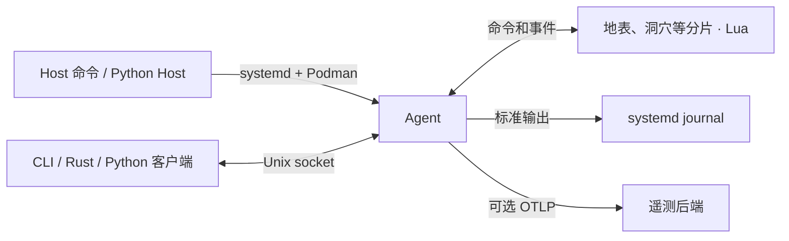

# 饥荒联机版专用服务器

[English](README.md) · 简体中文 · [下载发行版](https://github.com/LetsStarveTogether/dst-server/releases)

用 Rust Agent 运行饥荒联机版房间，通过 CLI 或 Python 管理游戏、查看玩家活动。
每个房间使用一个容器，地表、洞穴等分片由同一个 Agent 管理。
按日程闭房期间，仍可通过本机 Unix socket 查询状态。



## 开一个房间

宿主需要 Linux x86_64、systemd 和支持 Quadlet 的 Podman。
在 CPython 3.15 环境安装与游戏镜像同一发行版的 wheel，即可使用 `dst-server` 命令。
本地编译 CLI 和配套镜像见 [源码构建说明](docs/deployment.md#build-from-source)。

示例在 `/srv/dst` 下创建 299 号房间，交给系统级服务运行。
用能管理系统 Quadlet 目录的账号执行，将 Klei 服务器令牌写入 `/run/secrets/dst_cluster_token`，首次开房前拉取镜像。

```sh
podman pull quay.io/wh2099/dst-server:latest
```

```python
import asyncio
from pathlib import Path

from dst_server import Host
from dst_server.settings import Room, build_template

token = Path("/run/secrets/dst_cluster_token").read_text().strip()
room = Room(
    number=299,
    template="pure_survival",
    cluster=build_template("pure_survival", number=299, token=token),
    deployment={"volume_idmap": "uids=0-1000-1;gids=0-1000-1"},
)
asyncio.run(Host("/srv/dst", "/etc/containers/systemd").create(room))
```

示例中的目录归 root 所有，卷映射允许容器内 UID/GID 为 1000 的游戏进程读写。
其他宿主请按目录实际归属调整映射。

```sh
dst-server host start --room 299
dst-server host status --room 299
dst-server call list_players --socket /srv/dst/299/.dst-agent.sock
```

## 日常操作

| 操作 | 命令 |
| --- | --- |
| 列出受管房间 | `dst-server host list` |
| 请求游戏存档 | `dst-server call save --socket /srv/dst/299/.dst-agent.sock` |
| 跟随房间日志 | `dst-server logs journal --unit dst-299.service --follow` |
| 导出备份 | `dst-server archive export 299 --output room-299.7z` |
| 恢复前查看备份内容 | `dst-server archive import room-299.7z` |
| 查看游戏调用及参数 | `dst-server describe` 或 `dst-server describe --shard` |

离线改配置前先停服务。
用 Host 编辑时，游戏原生配置和生成的 Quadlet 会一起更新。

```sh
dst-server host stop --room 299
dst-server host edit --room 299 --set '/cluster/settings/max_players=12'
dst-server host start --room 299
```

## 详细指南（英文）

- [房间配置、SDK 和归档](docs/rooms.md) 涵盖模板、Mod、玩家管理和恢复存档。
- [玩法历史与遥测](docs/observability.md) 介绍如何选择采集事件、按玩家统计行为。
- [部署与维护](docs/deployment.md) 涵盖开闭房日程、自动恢复和现有房间的升级步骤。
- [开发与验证](docs/testing.md) 列出 Rust、Python、Lua 测试及隔离游戏服的演练方法。

[Steam 玩家组](https://steamcommunity.com/groups/lst99) · [Discord](https://discord.gg/4N3aeNsFt8)
