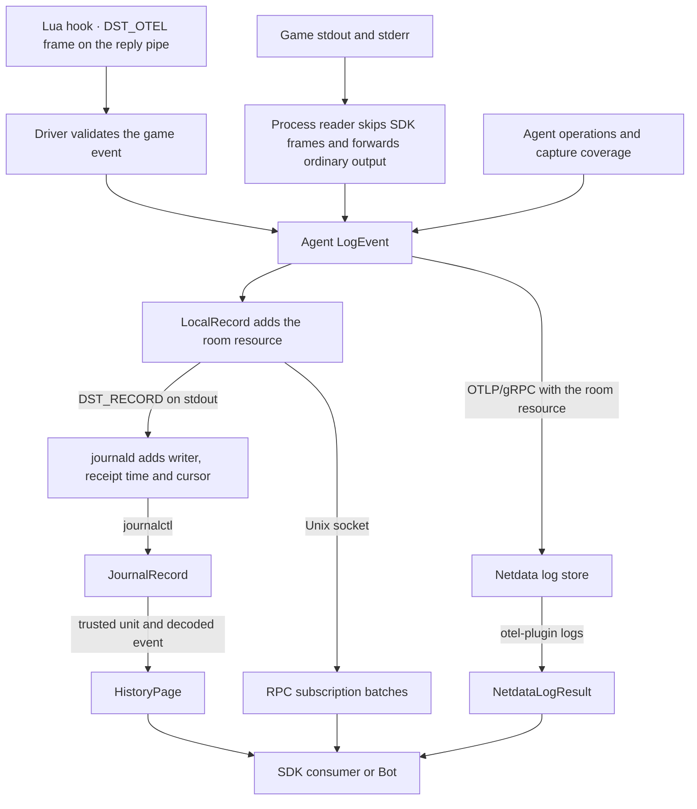

# Log Records and Queries

A room exposes gameplay through its journal, its live Agent socket and an optional OTLP store.
Each path preserves the event UID and supplies its own evidence about timing, progress and loss.

## From a Game Event to a Query Result



Lua captures the game clocks and assigns a sequence on attempted delivery.
An action discarded from the play queue before a send has no sequence.
The process reader consumes SDK frames on the reply pipe (FD4) and suppresses recognized frame prefixes on stdout/stderr.
The driver checks the event schema, launch nonce, shard generation and sequence.
It assigns the observation time and UID before the Agent sends the record to the enabled outputs.
Group game clocks by room, shard, launch nonce and generation. Shards started together can share a nonce.
Compare copies of the same observation by `log.record.uid`. [Process reader][process] · [Driver][driver] · [Room delivery][delivery]

The lifecycle socket also carries `room_status` snapshots published directly by the room, without a record UID.
The exporter reports its own `dst.telemetry.exporter_health` through the local outputs, even when OTLP delivery fails.
An error creating the exporter can appear only on Agent stderr.
The driver sends its diagnostics on `events`. Summaries of native Lua errors also use `dst.runtime.diagnostic` on `lifecycle`.

## Field Ownership

| Layer | Fields and how readers use them |
| --- | --- |
| Producer resource | `service.name`, optional `service.namespace`, `service.instance.id` and `dst.cluster.name` describe the Agent. A configured cluster name can differ from the Quadlet unit. |
| Record | `event_name`, `severity_text`, `observed_timestamp_ns` and optional trace context describe one observation. `attributes` carries `log.record.uid` and, where applicable, the shard, attempt, generation, sequence and operation ID. |
| Body | Gameplay history validates `body` against the event schema. `dst.server.log` has a stream and a line. `dst.mod_update` has a text body and carries its stream in `attributes`. |
| Journal entry | An intact Agent line has framed JSON in `MESSAGE`. The reader gets `__REALTIME_TIMESTAMP` and `__CURSOR`. The trusted fields `_SYSTEMD_UNIT`, `_SYSTEMD_USER_UNIT` and `_UID` describe the credentials journald attributed to the entry. Inherited stdout can carry the credentials of the process that opened the stream. |
| OTLP instrumentation | The exporter puts the resource on `ResourceLogs` and records under the `dst-server` scope with the Agent package version. Local records carry the resource alongside the event. |
| OTLP request | The exporter attaches `OTEL_EXPORTER_OTLP_LOGS_HEADERS`, or the shared headers, as metadata on each export RPC. Keep exporter credentials in the transport. Surface a reason suitable for the Bot when reporting a collector error. |

The journal window uses receipt time, the Agent records observation time, and the game supplies clocks relative to a run.
OTLP leaves the absolute event timestamp unset for gameplay and exports the Agent's observation timestamp.
Netdata 2.12.3 stores the OTLP event timestamp, then falls back to observation time, then a receiver timestamp.
For current gameplay its `timestamp_ns` therefore carries Agent observation time at nanosecond precision. [Netdata clock][clock]
For game order, compare tick, monotonic time and sequence within one shard run. [Log encoding][encode] · [OTLP model][otel]

## Current Query Interfaces

| Entry point | Selection, progress and result |
| --- | --- |
| `logs journal`, Python `JournalLogs.query/follow` | Unit patterns select records. `JournalQuery` supplies namespace, grep, time bounds, direction, cursor and limit. A finite query returns native fields, a cursor, `has_more` and diagnostics. Following starts at the tail by default. |
| `Host.journal/follow_journal`, `Host.diagnose` | Host converts each room number to an exact service name and chooses its systemd manager. Diagnose uses the same journal reader for the latest 50 entries. |
| `logs history`, Python `Host.history_page` and `read_history` | A journal grep selects candidates. The decoder checks the emitting unit, rooms, prefix, event header and body. Each page identifies the reader, preserves observation order, locates rejections and supplies a scoped checkpoint. |
| `logs telemetry`, Python `NetdataLogs.query` | Service name and namespace select a stream. Field filters, a regex query or the participant `userid` selector narrow records. `fields` selects the output columns. Results preserve repeated field values, the effective whole-second window and the plugin's match and truncation evidence. |
| `logs telemetry --structured`, Python `NetdataLogs.search` | Search a known Agent instance and UTC interval. Gameplay and coverage each report verified hits, native candidate counts, truncation, file diagnostics and any failure. |
| Python `subscribe_history` | Subscribe to gameplay and lifecycle. Each batch identifies its stream, drops, closure or transport error. `live.backfill(since, until=end)` reads a specified journal receipt window. |
| `subscribe`, Python `Client.subscribe` | The room socket selects the Agent. The stream kind selects gameplay and diagnostics (`events`), operations and coverage (`lifecycle`) or process output (`logs`). Each batch reports records, drops and closure. |

The CLI and Python bindings delegate native arguments, process lifetime and diagnostics to the Rust readers.
The journal reader handles cursor anchors and the grep exit status for no matches.
The Netdata reader verifies the plugin's returned window and counts.
A truncated diagnostic can leave the total unknown. [Journal reader](../crates/dst-server/src/logs/journal.rs) · [Netdata reader](../crates/dst-server/src/logs/netdata.rs) · [Process runner](../crates/dst-server/src/logs.rs)
Python's console script runs the CLI in its installed native extension. [Entry point][entry] · [PyO3 readers][pyo3]
The Python iterator requests native history pages through Host. [Host mapping][host] · [History decoder][history]

Journal `namespace` selects a journald instance. Netdata `service_namespace` selects an OTLP service stream.
The CLI flags `--timeout`, `--max-record-bytes` and `--max-output-bytes` bound the read operation.
The total output bound and completion timeout apply to finite reads.
Netdata also limits concurrent plugin processes.

### Journal Selection

| Manager and requested units | Native selection |
| --- | --- |
| System, named units | One `--unit=PATTERN` per distinct pattern across all readable files in the selected namespace |
| System, units omitted | `--system` |
| Current user, named units | One `--user-unit=PATTERN` per distinct pattern across readable files. journalctl scopes the service's own entries to the invoking UID and can include manager or coredump entries about the unit. |
| Current user, units omitted | `--user` |

Rust callers can also pass `None` directly to the raw reader to leave both file and unit selection to journalctl.
An explicitly empty list of unit patterns is invalid.
Under persistent journald storage with `SplitMode=uid`, a system service can write into the journal for its UID.
The query runs with the reader's permissions. [journalctl file and unit selection](https://www.freedesktop.org/software/systemd/man/latest/journalctl.html) · [journald file splitting](https://www.freedesktop.org/software/systemd/man/latest/journald.conf.html#SplitMode=)

`JournalRecord.unit` is a display label and can name the subject of a systemd manager message.
Use `record.emitting_unit(user=host.user)` for attribution.
For a PID 1 message about `dst-001.service`, the label can be `dst-001.service` while the writer is `init.scope`.

Both system and user services can write to a file selected by the storage layout.
Structured history also checks the trusted emitting unit and, for user services, the journal entry's UID.
Queries without named units retain the manager's file selection. [Unit matching][journalctl]

An unreadable journal file can be skipped silently.
A clean empty page is compatible with a quiet room, a wrong namespace or unavailable files. [File access][journal-open]

### The Room Log Incident

The incident window was 2026-11-22 from 17:15:51 inclusive to 17:25:51 exclusive in Asia/Shanghai.
In room 001, the Agent wrote stdout as `steam` (UID 1000).
Journald attributed the entry to `_SYSTEMD_UNIT=dst-001.service` and `_UID=1000` and stored it in the UID's journal.

| Read of the incident window | Room 001 | Room 200 |
| --- | ---: | ---: |
| SDK with named unit and `--system` | 0 | 0 |
| Comparison with the same unit filter across readable journals | 696 | 75 |

The incident report matched the comparison's event IDs against Netdata one by one.
The Bot had treated the original successful empty reads as evidence of source availability.

## Structured History Interface

The journal CLI, Python history and live readers share the native envelope decoder and gameplay predicate.
Raw journal records, projected Netdata hits and socket batches keep their native result types.

### Selection and Attribution

| Input | Contract |
| --- | --- |
| Room and source | Require one or more `--room` values in 000–299 and reuse the Host mapping to exact units. Journal history uses the manager selected by Host or CLI `--user` and accepts one `--namespace`. Record the effective reader identity. Python accepts `namespace=` on history queries. |
| Time | Require absolute, timezone-aware bounds and normalize to UTC. Journal history selects by receipt time in `[since, until)` and processes entries in native scan order. Netdata exposes its effective whole-second window and the timestamp on each hit. |
| Gameplay | Repeatable `--event` and `--shard`, and one literal `--userid`, map to `EventFilter(events, shards, userid)`. An omitted list is unconstrained. Deduplicate repeats, match alternatives within a list, and require every populated dimension to match. Names and IDs use exact, case-sensitive comparison. |
| Coverage | `coverage_only=True` or `--coverage-only` accepts the room and shard selection. Reject event and player constraints in this mode. A regular history scan includes coverage for the selected shard runs even when no gameplay matches. |
| Progress | `--page-size` bounds raw candidates per journal page. `--cursor` takes a cursor returned by the same reader. A page of zero selected gameplay records can still carry progress, coverage or diagnostics. |

Use Rust's existing event registry, schema validator and participant paths for the CLI and PyO3. [Schema][schema] · [Roles][roles]
Validate event names up front. Preserve literal shard names, including historical names absent from current config.
A player matches any observed participant role, including repeated roster entries.
The CLI command and Python predicate both select meals involving the player.

```sh
dst-server logs history --room 1 --event dst.player.ate --userid KU_example \
  --since 2026-11-22T17:15:51+08:00 --until 2026-11-22T17:25:51+08:00
```

To count meals the player **ate**, check the eater role. The feeder can be a different player. [Meal schema][meals]

```python
from dst_server import EventFilter, read_history

meals = EventFilter(events=("dst.player.ate",), userid="KU_example")
async for page in read_history(host, [1], since=start, until=end, where=meals):
    for meal in page.records:
        if meal.event["data"]["player"].get("userid") == "KU_example":
            print(meal.uid)
```

A normalized observation preserves the producer's UID and records how it was obtained.
Journal observations carry emitting unit, receipt time and cursor. A socket observation carries the room and stream.
Validate full gameplay envelopes before applying the predicate.
Known gameplay can have an empty resource and missing optional severity or trace metadata.
When present, severity and trace IDs must satisfy the producer's validation.
Journal history requires a single UTF-8 message with unique JSON object keys at every level.
Coverage requires its Agent instance ID. A rejected candidate stays available through the raw reader.
A structured consumer gets its rejection reason and source position in `page.rejections`.
Use `page.observations` to process selected gameplay and coverage in native order.
A recognizable older schema can be reported as unsupported. An ambiguous shape stays unclassified.
Test meals with the former food object and the current string field. [Early meal schema][legacy-meal]
Legacy `dst.player.chat` could carry a whisper. A projection that lost this distinction must never become public chat.
Unsupported schemas retain a rejection and a raw journal position. [History fixtures][history-test]

### Journal Scan and Resume

1. Select files and units, then scan history candidates in native order using a bounded page and lookahead.
   For each candidate, check the trusted emitting unit, decode and validate, then apply the gameplay predicate.
   Keep the same candidate stream across gameplay filters so coverage, rejections and cursor progress stay visible.
   Compare any future grep optimization against that reference scan, including nested lookalikes and malformed candidates.
2. Apply coverage changes in candidate order **before** splitting a page into gameplay and coverage lists.
   Retain receipt time and source cursor for observations returned to callers.
   Keep journal iteration order when receipt timestamps tie. Each live stream has its own order.
   The history CLI emits one page with the scan's `next_cursor` and `has_more`.
   Consume empty intermediate pages. Python iterator exhaustion signals completion, including an empty final page.
3. Commit the processed results, UID deduplication state and the raw page cursor together.
   Bind a persisted checkpoint to host, effective UID/groups, manager, namespace, rooms, absolute window, direction,
   coverage mode, normalized predicates and the reader's file and unit selection rules.
   Version this context when file selection or decoding changes which records can be returned.
   `page.reader` identifies the host by its machine ID or fallback boot ID.
   It includes the effective UID and GID, supplementary groups and configured journal executable.
   Python accepts `checkpoint=page.checkpoint`. The CLI accepts the same JSON object via `--checkpoint @file`.
   The reader verifies the checkpoint scope before invoking journalctl. A bare cursor contains no query selection.
   Page size may change.
   A cursor from room 001 can remain valid after adding room 200 and skip that room's earlier records.
   A changed selection starts a new scan.
4. Round-trip SDK cursors verbatim. The current reader checks the first entry's cursor string against the supplied anchor.
   systemd allows multiple spellings for the same entry and can seek to a neighbour if an entry is unavailable.
   A rejected anchor is an explicit error. Offer a bounded rescan of retained data with UID deduplication.
   Future support for arbitrary native cursors requires semantic anchor validation. [systemd cursor contract][cursor]

Forward pages omit the native line limit.
The reader consumes the supplied anchor and stops the child after one lookahead entry.
This preserves native iteration order even on journalctl versions that take a positive line count from the tail.
Unanchored follow starts at the live tail.
An explicit `since` or cursor requests history across boots with `--boot=all` and `--no-tail` when the limit is omitted.
A follow with `since` accepts a native backlog limit. Following a cursor requires omitting the limit.
If a quiet stream must immediately confirm its anchor, check the cursor with a finite query before following. [journalctl][journalctl]
Receipt time can move backwards. Native time bounds can then skip an entry inside the requested window.
Treat a known clock step as uncertain coverage when verifying a window.

### Netdata Search

Resolve a room for the requested time using its tenant, service namespace/name, cluster resource and Agent instances.
Rooms may share a cluster name, change it or start a new instance.
For example, a trusted journal unit and its Agent record can associate an instance with a room during its run.
Report unresolved attribution when only the current name is known.
Pass a `RoomStream` for each historically attributed instance to `NetdataLogs.search`.
`RoomStream.from_journal(record, tenant=...)` derives the binding from a trusted journal observation and its resource.
An unresolved room has no binding to query. Both readers default to the `default` tenant.

```python
from dst_server import NetdataLogs, RoomStream

source = RoomStream.from_journal(room_record)
result = await NetdataLogs().search(
    source, since=start, until=end, where=meals, fields=("body.food",), limit=500
)
for hit in result.gameplay.hits:
    print(hit.uid, hit.values("body.food"))
```

The CLI accepts the same selection as JSON using `logs telemetry --structured @file`.
Its input has `source`, `since`, `until`, `where`, `fields` and `limit`.

Netdata 2.12.3 combines alternatives for the same filter field and intersects different fields.
Its text query matches a regex against whole `key=value` pairs.
The structured search compiles representable predicates for the plugin. [Filter grammar][net-filter]
For names containing commas or surrounding spaces, read a safe superset and compare the literal values locally.
Round fractional bounds outwards for the native search, then apply the original bounds to each hit's `timestamp_ns`.
Request predicate fields internally before shaping a caller's explicit projection. An empty projection requests all fields.
The raw `userid` search also reaches administration records.
For structured gameplay hits require a recognized gameplay name, an unambiguous UID and evidence for each requested match.
Preserve repeated participant values. Missing or conflicting required fields cannot establish a match.
The verifier uses the roles in the particular event's schema. For example, a victim field cannot attribute a meal to a player.
Flat strings lose JSON types and can represent different original paths. A projected hit carries that limitation.

Read coverage by room, shard and instance independently of player/event filtering and track its read limits separately.
A native participant regex alone would discard every coverage record.
Return the number of locally verified matches and the plugin's candidate-row total under distinct names.
A capped candidate read can return zero verified hits while later candidates match.
Report row multiplicity as well as distinct UIDs. OTLP can retry a batch after an uncertain acknowledgement. [OTLP delivery][otlp]

The plugin returns a bounded page and exposes no continuation cursor through this CLI.
Reversing the displayed page does not enumerate the remaining rows.
Time slicing can help until a single second exceeds the row or byte budget. Mark that result incomplete.
A missing directory and an unreadable or corrupt index can both yield a successful empty result.
Keep file warnings, missing-file evidence and unknown totals alongside the counts.
With zero rows, `files_found` means the plugin found store files and reported a clean count.
Room visibility still needs its own evidence.
A failure on either read gives the structured CLI a failing exit status while its JSON preserves both results.
A projected coverage marker identifies an observation.
Assessing capture also requires its profile, hook and loss data. [Discovery][net-discover] · [Output][net-output]

### Live Delivery and Capture Evidence

`subscribe_history(host, room, where=...)` opens and drains both socket streams into a bounded queue.
Keep diagnostics, lifecycle snapshots, coverage and transport failures distinct from malformed gameplay.
For live gameplay with coverage, subscribe to and drain both `events` and `lifecycle`.
Each starts at its own live tail. They have independent loss counts and no shared cursor or registration barrier.
After registering, read overlapping journal receipt windows while continuing to drain both streams.
The socket can publish before journald receives stdout.
A record published before `registered_at` can have a later journal receipt.
Advance the receipt window on subsequent passes and deduplicate by UID.
Backpressure on the queue reaches the native subscription, which reports skipped records in `dropped`.
A transport failure appears in the affected stream's terminal `batch.error`.
Its drop count is unknown (`None`) if no native batch arrived.
The other stream continues. Keep the affected interval open for reconciliation.
Process records on a final `closed=true` batch. An empty filtered batch still carries its drops and closure.
Recover batch order using `observation_indices`, `auxiliary_indices` and each rejection's `index`.
A subscription's `dropped` applies to the original stream for that subscriber, including records outside its filter.
An OTLP acknowledgement applies to the receiving hop. Partial success counts rejected rows without identifying their UIDs.
[RPC batches][rpc] · [Broadcast semantics][broadcast] · [OTLP delivery][otlp]

Use `coverage.capture_for(event_name)` to read the profile and hook states **at the time of that sample**.
Seed it from a preceding coverage record for that run and process subsequent changes in source order.
A healthy `timeline` shard does not capture meals. Entity-death coverage also depends on the victim and attribution.
Daywalker capture requires the master shard.
Combat contacts for the same opponent key are sampled at most once per ten seconds of simulation time.
A capability can be unsupported while the overall profile reports active.
Coverage publishes changes and remembers each attempted publication, including one a reader missed.
An old active sample cannot establish that the run lived through the end of a window.
Attribute counter changes to the interval between samples and keep uncertain run boundaries explicit. [Capture profiles][profiles]

| Loss evidence | Scope for comparing counters |
| --- | --- |
| Lua errors and `play_queue_dropped` | Within one shard generation. Work can be lost before it acquires a sequence. |
| `shard_loss` | Within the shard launch/attempt across generations. One dropped reply can also cause a sequence gap. |
| `room_loss.stdout_dropped` | Once per Agent instance. Several shards can report the same counter. A successful stdout write only acknowledges writing the line. |
| Subscription and OTLP | Per subscriber/stream or exporter batch. Neither count identifies the affected player. |

### What a Bot Can Report

| Evidence to expose per source | What it establishes |
| --- | --- |
| Read outcome and effective selection | The room, reader, store and time basis used, whether the request finished, and any cursor, limits or errors. |
| Source visibility | A known room record read by this identity, evidence for the retained interval, and any missing or unreadable files. Finding one historical entry demonstrates current access to that entry. |
| Observed results | Verified rows, distinct observed UIDs and rejected candidates. Netdata also reports its native candidate count when known. |
| Capture | The event capability and shard run, known gaps and intervals whose coverage is unknown. |

A successful empty read supports **0 events observed**.
When access, retention or capture is unknown, expose that uncertainty alongside the count.
Two readable stores can agree on every UID after a common upstream loss.
Compare returned row counts, duplicates and UID differences after exhausting journal pages and checking the Netdata cap.
Account for receipt versus observation time at both boundaries, and retain the result of each source independently.
[Coverage producer][coverage] · [Native acceptance procedure][acceptance]

## Resuming and Reconciling Bot Results

In the consumer's database, store facts with a unique key on (report, event UID).
Store journal occurrences by reader, emitting unit and cursor so retries preserve raw multiplicity.
Commit the page's occurrences, new facts, aggregate changes and checkpoint in one transaction.
A page with no gameplay can still carry rejections, coverage or further pages.
If the reader's file visibility widens, recompute affected retained windows from their original start.
This also applies to a window previously marked complete with no cursor.
Record the part outside retention as unknown.

For a live handover, register both subscriptions before reading history.
Use the same fact key for journal and live arrivals, and schedule fresh receipt windows as time advances.

```python
import asyncio

from dst_server import subscribe_history


async def reconcile(live, store):
    async for start, end in store.receipt_windows():
        pages = live.backfill(start, until=end)
        while True:
            try:
                page = await anext(pages, None)
            except Exception as error:
                await store.defer_window(start, end, error)
                break
            if page is None:
                break
            await store.apply_journal_page(page)


async with (
    subscribe_history(host, 1, where=meals) as live,
    asyncio.TaskGroup() as tasks,
):
    backfill = tasks.create_task(reconcile(live, store))
    try:
        async for batch in live:
            await store.apply_live_batch(batch)
    finally:
        backfill.cancel()
```

Here `store` is the caller's database adapter.
Its scheduler starts at the last durable receipt position.
It yields overlapping windows with elapsed end times and continues past registration.
On a journal read error, it records the reason and schedules a later retry while the live reader continues.
Persist pending windows so a shutdown during reconciliation can resume them.
Keep the two subscriptions' drop counts, each source's completion status and rejection reasons with the report.
A completed read under a given service identity describes only its visible data.
For capture comparisons across sources, subscribe before a known action and marker, drain each output and compare raw UIDs.
Large records can split independently on the journal path. [Native checks][acceptance] · [Journald][split]

[process]: ../crates/dst-server/src/process.rs
[driver]: ../crates/dst-server/src/driver.rs
[delivery]: ../crates/dst-server/src/room/telemetry.rs
[entry]: ../python/dst_server/__main__.py
[pyo3]: ../crates/dst-server-python/src/logs.rs
[host]: ../crates/dst-server/src/host.rs
[history]: ../python/dst_server/history.py
[encode]: ../crates/dst-server/src/telemetry.rs
[otel]: https://opentelemetry.io/docs/specs/otel/logs/data-model/
[clock]: https://github.com/netdata/netdata/blob/v2.12.3/src/crates/ng-flatten/src/logs.rs#L163-L172
[journalctl]: https://www.freedesktop.org/software/systemd/man/latest/journalctl.html
[journal-open]: https://www.freedesktop.org/software/systemd/man/latest/sd_journal_open.html
[schema]: ../crates/dst-server/src/events.rs
[roles]: ../crates/dst-server/src/events/types.rs
[meals]: ../crates/dst-server/src/events/types.rs
[legacy-meal]: https://github.com/LetsStarveTogether/dst-server/blob/686388fd2784cc10689fb5f15435e1314c4fca5c/crates/dst-server/src/events/types.rs#L344
[history-test]: ../tests/rust/check_history.py
[cursor]: https://www.freedesktop.org/software/systemd/man/latest/sd_journal_get_cursor.html
[net-filter]: https://github.com/netdata/netdata/blob/v2.12.3/src/crates/sfsq/src/logs/query.rs
[otlp]: https://opentelemetry.io/docs/specs/otlp/
[net-discover]: https://github.com/netdata/netdata/blob/v2.12.3/src/crates/sfsq-cli/src/discover.rs
[net-output]: https://github.com/netdata/netdata/blob/v2.12.3/src/crates/sfsq-cli/src/output.rs
[rpc]: ../crates/dst-server/src/rpc.rs
[broadcast]: https://docs.rs/tokio/latest/tokio/sync/broadcast/index.html
[coverage]: ../crates/dst-server/src/events/coverage.rs
[profiles]: observability.md#capture-profiles
[acceptance]: testing.md#checking-the-native-game-and-external-services
[split]: https://www.freedesktop.org/software/systemd/man/latest/journald.conf.html#LineMax=
